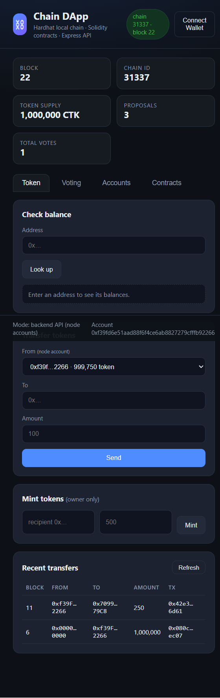
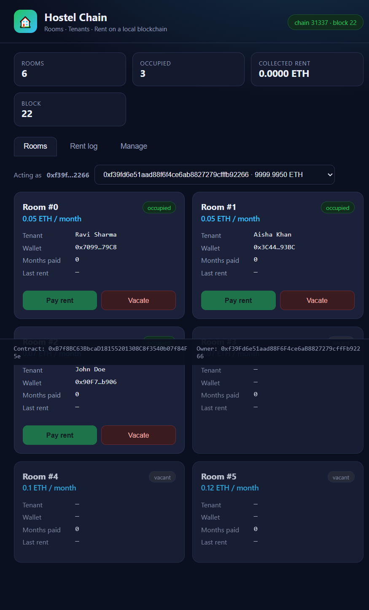
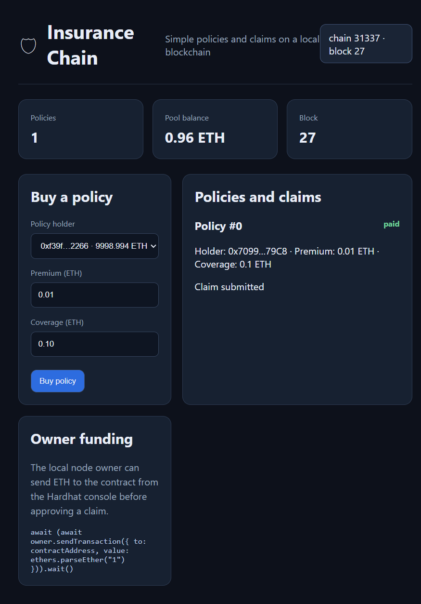

# Blockchain Projects

This repository contains two runnable local-blockchain demonstrations built with
Solidity, Hardhat, ethers.js, Express, and plain HTML/CSS/JavaScript.

## Projects

| Project | Description | App |
| --- | --- | --- |
| [`blockchain-dapp/`](./blockchain-dapp/) | ERC-20-style token transfers and owner-managed on-chain voting | `http://localhost:3000` |
| [`hostel-tenant/`](./hostel-tenant/) | Hostel room management, tenant assignment, and tenant-only rent payments | `http://localhost:3001` |
| [`insurance/`](./insurance/) | Simple policy purchase, claim submission, and owner payout | `http://localhost:3002` |

## Screenshots

### Chain DApp



The Chain DApp homepage exposes token balances, transfers, minting, voting,
local accounts, and deployed contract information.

### Hostel Chain



The Hostel Chain homepage shows room occupancy, acting account selection,
tenant-only rent controls, rent history, and owner management actions.

### Insurance Chain



The Insurance Chain homepage keeps the workflow intentionally small: buy a
policy, submit one claim, and approve the payout as the contract owner.

## Requirements

- Node.js 18 or newer
- npm
- Git
- A local Hardhat JSON-RPC node

The projects use Solidity `0.8.24` and the local Hardhat network with chain ID
`31337`.

## Quick start

Run the local chain in a dedicated terminal:

```powershell
cd D:\Mr.Ashish\Blockchain\blockchain-dapp
npm install
npm run compile
npm run node
```

Keep that terminal running. In a second terminal, deploy and start the Chain
DApp:

```powershell
cd D:\Mr.Ashish\Blockchain\blockchain-dapp
npm run deploy
npm start
```

Open <http://localhost:3000>.

In another terminal, deploy and start Hostel Chain against the same local node:

```powershell
cd D:\Mr.Ashish\Blockchain\hostel-tenant
npm install
npm run compile
npm run deploy
npm start
```

Open <http://localhost:3001>.

For the Insurance Chain, use the same local Hardhat node and run:

```powershell
cd D:\Mr.Ashish\Blockchain\insurance
npm install
npm run compile
npm run deploy
npm start
```

Open <http://localhost:3002>.

To stop a local node or backend, stop the terminal process that started it.
Deploying again replaces the local deployment addresses in
`deployments/localhost.json`.

## `blockchain-dapp` features

- `ChainToken.sol`: ERC-20-style token with balances, allowances, transfers,
  `transferFrom`, and owner-only minting.
- `Poll.sol`: owner-created proposals, one vote per address per proposal, vote
  totals, and proposal history.
- Express API backed by ethers.js for reads and writes using unlocked Hardhat
  accounts.
- Optional browser-wallet mode through the Connect Wallet control.
- UI tabs for token operations, voting, accounts, and contract metadata.
- Deployment script seeds one million CTK and three example proposals.

Useful commands:

```powershell
npm run compile
npm run deploy
npm start
```

## `hostel-tenant` features

- Add rooms with an owner-defined monthly rent.
- Assign an unlocked local account as a tenant.
- Vacate occupied rooms from the owner account.
- Pay exactly one month of rent from the assigned tenant account.
- Display on-chain room state, contract balance, and `RentPaid` events.
- Select the acting local account from the UI.
- Rent controls are disabled unless the acting account is the room tenant,
  matching the smart contract authorization rule.

Useful commands:

```powershell
npm run compile
npm run deploy
npm start
```

## `insurance` features

- Buy a policy by paying a premium and choosing a coverage limit.
- Submit one claim as the policy holder.
- Approve and pay a valid claim as the contract owner.
- Display policy state, claim state, contract balance, and local accounts.
- The contract accepts direct ETH funding so the owner can fund claim payouts.

Useful commands:

```powershell
npm run compile
npm run deploy
npm start
```

## Contract behaviour

### ChainToken

The deployer becomes `owner` and receives the initial supply. `transfer`
moves tokens from the caller, while `approve` records an allowance that a
spender can use through `transferFrom`. Only the owner can call `mint`.
Transfers, approvals, and minting emit standard-style events.

### Poll

The deployer becomes the poll owner. Only the owner can create a proposal.
Any address may vote once for each proposal; the contract records that vote in
`hasVoted` before incrementing the proposal and global vote totals. Repeated
votes revert.

### Hostel

The deployer becomes the hostel owner. Only the owner can add rooms, change
rent, assign tenants, and vacate rooms. `payRent` requires all of the
following:

1. The room exists and is occupied.
2. `msg.sender` is exactly the assigned tenant.
3. `msg.value` exactly equals the room rent.

On success, the contract increments `monthsPaid`, stores the payment timestamp,
and emits `RentPaid`. The owner can withdraw up to the contract balance. The
frontend therefore disables the Pay rent button for owners and other accounts;
switch the acting-account selector to the assigned tenant to make the valid
transaction.

### Insurance

The deployer is the contract owner. Anyone can buy a policy by sending a
positive premium and coverage amount. Only the policy holder can submit one
claim, and the claim cannot exceed the policy coverage. Only the owner can
approve a submitted claim; approval sends the selected payout to the holder
and deactivates the policy. The contract must have enough ETH for the payout.

## API overview

Both backends serve the frontend and JSON endpoints under `/api`.

### Chain DApp

- `GET /api/status`
- `GET /api/accounts`
- `GET /api/token/balance/:address`
- `POST /api/token/transfer`
- `POST /api/token/mint`
- `GET /api/token/transfers`
- `GET /api/poll/proposals`
- `POST /api/poll/proposals`
- `POST /api/poll/vote`

### Hostel Chain

- `GET /api/status`
- `GET /api/accounts`
- `GET /api/rooms`
- `POST /api/rooms`
- `POST /api/rooms/:id/occupy`
- `POST /api/rooms/:id/vacate`
- `POST /api/rooms/:id/pay`
- `GET /api/payments`

## Validation

Compile each Solidity project after installing dependencies:

```powershell
cd D:\Mr.Ashish\Blockchain\blockchain-dapp
npm run compile

cd D:\Mr.Ashish\Blockchain\hostel-tenant
npm run compile
```

Both projects were compiled successfully during setup and the local API
endpoints return chain ID `31337`.
